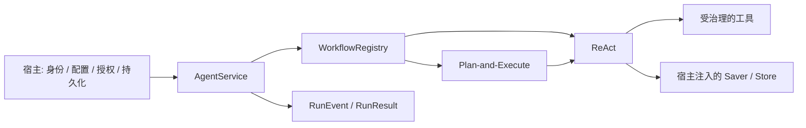

# Agent Core

**一个可嵌入业务应用的 Python Agent 运行内核。**

围绕一次 Run，提供异步流式执行、工具治理、预算、取消、checkpoint 恢复，以及 ReAct / Plan-and-Execute 组合。业务应用通过显式依赖注入提供模型、权限、持久化和领域策略。

`Python 3.11–3.13` · `LangChain` · `LangGraph` · `Deep Agents` · `Pydantic`

## 工程重点

- **宿主与内核分离**：不读取环境变量、不创建业务数据库连接；模型、工具授权、Saver/Store 与公开事件投影由宿主提供。
- **一次执行的完整生命周期**：`AgentService.astream` 原生异步；同步 `stream` 驱动同一实现；取消、成功和失败路径管理所属资源。
- **工具调用有明确边界**：参数校验、授权、总量/分类预算、超时、受限只读重试与结果提交使用统一治理入口。
- **恢复保留执行事实**：校验 Run 身份、版本和 checkpoint；保留消耗账本，缺失 checkpoint 时拒绝静默重跑。
- **复用社区组件**：ReAct 使用 `create_agent`；计划执行由薄 `StateGraph` 编排；Memory/Skills/Filesystem/Todo 复用公开 middleware 与 backend。



## 快速运行：离线工具演示

安装依赖需要访问包索引。演示使用确定性 Fake 模型与加法工具，不请求模型服务，不连接数据库，也不读取凭据。

```bash
git clone https://github.com/cont1nu1ty/agent_core.git
cd agent_core
uv sync --frozen
uv run --frozen python examples/offline_react.py
```

演示通过真实 ReAct 图调用 `add_numbers`，输出工具与答案事件，再打印最终结果及工具调用消耗。实现见 [offline_react.py](examples/offline_react.py)。它用于展示组件如何连接，不构成真实模型效果评测。

## 开发与验证

```bash
uv sync --frozen
uv run --frozen python scripts/check_core.py
uv run --frozen python scripts/check_docs.py
uv build --wheel --out-dir dist
uv run --frozen python scripts/check_core.py --wheel dist/stategrid_agent_core-0.2.0-py3-none-any.whl
```

`check_core.py` 拒绝宿主/业务数据库客户端导入与网络、SQLite、子进程 I/O。wheel 模式在临时仓库外目录导入构建产物并运行相同契约测试；不会安装依赖。验证范围见 [测试说明](docs/testing.md)。CI 定义见 [core.yml](.github/workflows/core.yml)，远端结果以实际运行记录为准。

## 设计与笔记

- [核心架构与 API](docs/architecture.md)：调用链、状态归属、扩展点与恢复契约。
- [计划执行](docs/planning.md)：版本确认、整计划 ReAct、结果检查与累计预算。
- [记忆与上下文](docs/memory-context.md)：正式发布、Notes/Todo、历史来源与摘要边界。
- [为什么把宿主与内核分开](docs/notes/host-boundaries.md)
- [工具调用为什么需要统一治理](docs/notes/tool-governance.md)
- [checkpoint 恢复为什么不能等同于恰好一次执行](docs/notes/execution-recovery.md)

## 包身份与范围

本仓库由既有工程中的通用内核包独立整理。保留发行名 `stategrid-agent-core==0.2.0` 和导入名 `agent_core`，减少迁出时的调用与打包漂移；发行名中的历史前缀不代表业务依赖。源码、核心测试和锁文件随包迁出；领域应用、配置、数据与原工程 Git 历史不包含在此仓库。

本仓库提供库与离线示例。数据库迁移、业务队列、认证、审批界面和公开事件字段过滤由接入应用负责。checkpoint 不保证任意外部副作用恰好执行一次；真实模型质量、PostgreSQL 跨进程恢复及费用/延迟收益需要独立验证。

尚未为本项目指定开源许可证。本次整理未新增 MIT 或其他授权；第三方依赖说明见 [THIRD_PARTY_NOTICES.md](THIRD_PARTY_NOTICES.md)。
